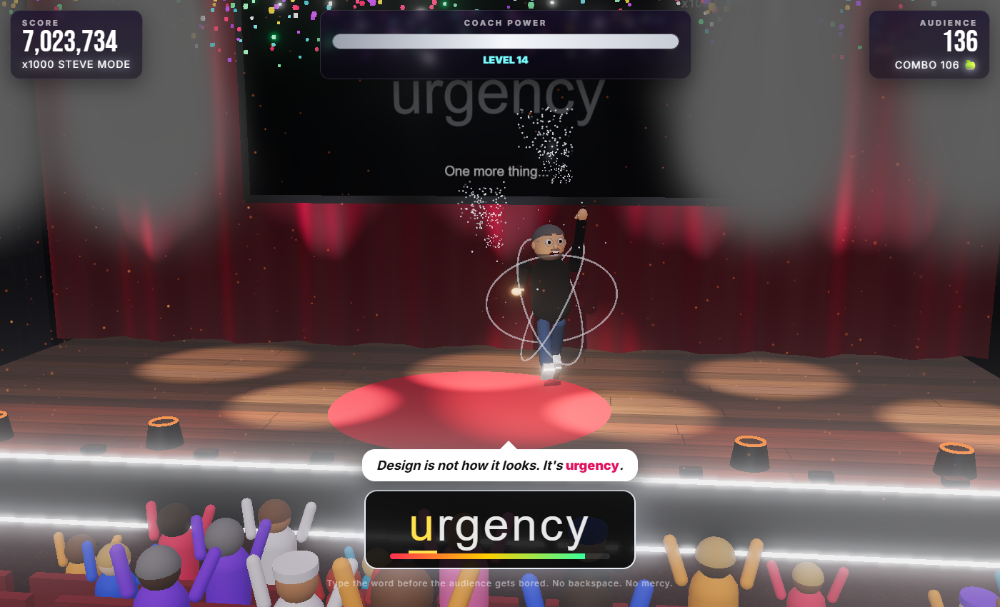

<div align="center">

# 🔥 OLIVER — Your Quantum Coach 🔥

**A 3D typing game where you keep a hyperactive motivational coach's TED-style talk alive by typing buzzwords on time.**

*Performance. Coffee. Uber. Tesla. Elon Musk. Type the words. Save the keynote.*


</div>

---

## 🎤 The pitch

Oliver is live on the **Quantum Talks** stage. He paces around, waves his arms, and gets more unhinged with every sentence. The audience is fragile.
Each sentence he says needs a **buzzword** or a full **power phrase**, and you're the one who types it.

- Type it **correctly and fast** → the crowd cheers, new people walk in through the entrance door, and Oliver gains coach power.
- **Typo or timeout** → people boo, throw tomatoes, shoes, bananas and coffee cups, and walk out. Oliver loses coach power.
- **Coach power hits zero** → the talk is over.

## 📸 Screenshots

| Mythical Coach Power (10x combo) | Things are going badly |
|:---:|:---:|
|  |  |
| **Steve Mode (100x combo)** | **Main menu** |
|  |  |
| **Talk over** | |
|  | |

## 🕹️ How to play

| Action | Result |
|---|---|
| Type each letter of the highlighted word | Sparks fly from Oliver's hands |
| Finish a word with **no mistakes** | **+1 combo**, applause, fire cannons, people join |
| Nail a **POWER PHRASE** (from level 2) | A full mantra like *"comfort zones are where dreams go to die"*. Worth tier ×4 points, with a generous timer |
| Reach **10x combo** | 🔥 **MYTHICAL COACH POWER**: Oliver catches fire, strobes, confetti, **points x10** |
| Reach **100x combo** | 🍏 **STEVE MODE**: a white flash, a mid-air spin, and Oliver comes down as a black-turtleneck, round-glasses keynote legend. The stage goes calm and minimal, and **points x1000** |
| Make a typo | Combo resets to 0, power drops, maybe a tomato. In Steve mode: *"STEVE HAS LEFT THE BUILDING"* |
| Run out of time | Big power loss, people walk out, more stuff gets thrown |
| Power reaches 0 | Talk over. *"Refunds are a limiting belief."* |

There is no backspace. Every **8 words** the level goes up: you get less time per word, and longer words show up more often.

### 💬 Power phrases

From **level 2**, Oliver starts dropping full **power phrases** (2,000 of them, 16 to 46 characters). They're marked with a pink **POWER PHRASE** tag. They start at 15% of prompts and grow to 35%, and you never get two in a row.

Phrase timers are based on characters per second rather than the word formula, so long phrases always stay doable:

```
phrase time = 2.2 s (reading) + characters / cps
cps         = 2.2 at level 2, +0.18 per level, capped at 4.5 (about 26 WPM rising to 54 WPM)
```

A 40-character phrase gets about **20 s** at level 2 and never less than about **11 s**.

### Scoring

```
points = (40 + letters × 10) × tier × (1 + time_left / time_total) × multiplier
tier       = 1 to 3 for words, 4 for power phrases
multiplier = 1000 at 100x combo (Steve mode), 10 at 10x combo (Mythical), otherwise 1
```

Your best score is saved in `localStorage`.

## 🚀 Running it

```bash
npm install
npm run dev       # http://localhost:5173
npm run build     # static production build in dist/
npm run preview   # serve the production build
```

It runs in any modern desktop browser with WebGL2. Check **Oliver's voice** on the menu if you want him to read his lines out loud (uses the browser's speech synthesis).

## ✨ What's on screen

- **Auditorium**: tiered velvet seating, carpet, side walls with a working entrance door, warm lobby light, and an `ENTRANCE` sign.
- **Stage**: wooden floor, red speaker circle, curtains with folds, a giant screen showing the current word, speaker stacks, footlights, and an LED strip.
- **Lighting**: six moving-head spotlights on a truss with visible light beams, a follow spot with shadows, colored uplights on the curtain, and bloom.
- **Fire cannons**: four of them, shooting flames, sparks and smoke, with flickering point lights.
- **Oliver**: built entirely in code. Suit, tie, pocket square, glasses, headset mic, a large hair quiff, and three glowing rings orbiting him. He walks, gestures, gets hit, celebrates, slumps when power is low, and catches fire in Mythical mode. In Steve mode he swaps to a black turtleneck, jeans, grey sneakers, rimless round glasses, grey stubble and a presentation clicker. He walks calmly, the lights go white and minimal, the screen turns into a clean black keynote slide, and his rings become a *Reality Distortion Field*.
- **Audience**: up to 136 people with varied looks. They follow Oliver with their heads, clap, cheer, boo, and throw things. Leavers stomp out through the door; newcomers walk in and find a seat.
- **Audio**: everything is generated in the browser with WebAudio (keyboard clicks, applause, boos, splats, whooshes, a level-up jingle, a keynote beat that speeds up in Mythical mode, and a big chord swell with calm keynote music in Steve mode). There are no audio files.

## 🗂️ Project structure

```
index.html          HUD, menu and game-over overlays
src/
  main.js           renderer, post-processing, game rules, input, main loop
  scene.js          auditorium, stage, truss, lights, light beams, big screen
  oliver.js         the coach: model, animation, aura, on-fire states
  audience.js       crowd: seating, enter/leave pathing, reactions, throwing
  fx.js             GPU particles (fire, sparks, smoke, confetti) + thrown objects
  audio.js          WebAudio sound effects and music
  words.js          1,454 buzzwords (3 difficulty tiers) + Oliver's lines
  phrases.js        2,000 power phrases (hand-written core + seeded template generator)
  style.css         HUD styling
```

## ➕ Adding buzzwords

Open `src/words.js` and add words to the `RAW` string, separated by `|` or new lines. Duplicates are removed automatically, and difficulty is worked out from word length and number of words:

- **Tier 1**: one word, at most 6 letters (`grit`, `uber`, `coffee`)
- **Tier 2**: everything else (`performance`, `Elon Musk`)
- **Tier 3**: 13 or more characters, or 3 or more words (`fake it till you make it`)

Add new Oliver lines to `LINES`, with `{w}` where the word goes.

Power phrases live in `src/phrases.js`. Add hand-written ones to `CORE`, or add vocabulary and templates to `TPL` and `TEMPLATES`. Phrases may only contain lowercase letters and spaces, and must be 16 to 46 characters long. The generator tops the list up to exactly `PHRASE_COUNT` (2000), using a fixed seed so every player gets the same set.

---

<div align="center">

*"I took an Uber to the mountains to find synergy."* — Oliver

</div>
